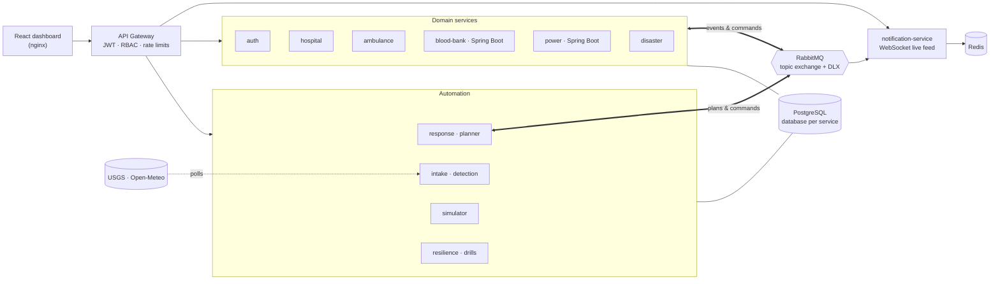
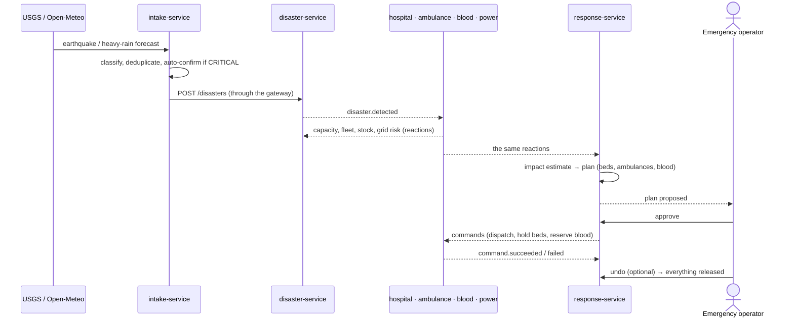

<div align="center">

# SentinelCloud

**A cloud-native emergency-response platform for a city's critical infrastructure.**

Hospitals, ambulances, blood banks and the power grid, coordinated in real time
when a disaster strikes: from automatic detection to a costed, approved and
reversible response plan.

[](https://github.com/Darshan07218/SENTINELCLOUD/actions/workflows/ci.yml)


</div>

---

## Overview

When a flood or an earthquake hits a city, the organisations that respond
(hospitals, ambulance services, blood banks, the power utility) each hold part
of the picture. SentinelCloud connects them through an event-driven
microservice architecture:

1. **Detect.** Public earthquake and weather feeds are watched continuously;
   a serious event becomes a disaster automatically, a lesser one waits for an
   operator to confirm.
2. **React.** Every service checks its own resources inside the affected area
   (free beds and ICU, available ambulances, blood stock, transformers at
   risk) and reports back within seconds.
3. **Plan.** A response engine estimates the people affected and the
   casualties, then proposes a plan: ambulances to dispatch, hospital beds to
   hold, blood to reserve, and what only a person can do.
4. **Act and undo.** On approval each action is executed exactly once by the
   service that owns the resource; the whole plan can be reversed.

Everything is visible live on a command-center dashboard with real maps,
forecasts and an event timeline, and the platform runs on Kubernetes with
autoscaling, monitoring, self-healing drills and a CI pipeline that verifies
the full system end to end.

> Academic project for a third-year Cloud Computing module. All data is
> synthetic or public; no real emergency service is connected. See
> [Limitations](#limitations).

## Highlights

| Area | What it does |
|---|---|
| **Automatic detection** | Polls USGS earthquakes and Open-Meteo rain and wind for the city; CRITICAL events auto-confirm, others go to an approval queue. Each source event is stored once. |
| **Real data** | 101 real Pune hospitals and 31 substations from OpenStreetMap, blood banks and ambulances at real hospitals, and the WorldPop 2020 population grid; every estimated figure is labelled as such. |
| **Impact-based planning** | The population in the affected area (WorldPop 2020) and per-type casualty rates size the response: beds, ICU, ambulances, blood. |
| **Validated models** | The casualty model is checked against 11 historical Indian disasters, the bed forecast against real hospital occupancy (tuned on 2021–22, tested on 2023), the transformer projection against real transformer telemetry. |
| **Resource reservation** | Approving a plan holds hospital beds and blood and dispatches ambulances; undo releases everything. Commands are idempotent and executed exactly once. |
| **Forecasting** | 24-hour bed-occupancy forecast per hospital (damped Holt smoothing over a trigger-recorded history) and a 0–100 transformer-risk score; both feed the planner. |
| **Reliable messaging** | Transactional outbox, publisher confirms, retries and dead-letter queues: no event is lost when the broker or a handler fails. |
| **Cloud-native operations** | Kubernetes manifests (Kustomize), HPA on CPU and KEDA on queue length, health probes, NetworkPolicies, graceful shutdown. |
| **Observability** | Prometheus metrics in every service, recording and alert rules with unit tests, Alertmanager, four Grafana dashboards. |
| **Resilience** | Six controlled failure drills (pod hang, crash, liveness failure, pod loss, traffic surge, broker outage) that advance only on observed cluster state. |
| **Security** | JWT with refresh-token rotation and reuse detection, role-based access at the gateway and in each service, least-privilege database roles, rate limits, strict CSP, audit log. |
| **Simulation** | Scripted disaster scenarios and background city activity for hands-free demos, driven through the public API like a real user. |

## Architecture



Every service owns its data (database per service, its own login role) and
talks to the others only through events or through the gateway. The full
design is in [`docs/SYSTEM-REFERENCE.md`](docs/SYSTEM-REFERENCE.md); the event
contract is in [`docs/EVENT-SCHEMA.md`](docs/EVENT-SCHEMA.md).

### A disaster, end to end



### Services

| Service | Stack | Responsibility | Port |
|---|---|---|---|
| `gateway` | Node / Express | Single entry point: JWT verification, role checks, rate limits, CORS, audit log, health aggregation | 8080 |
| `auth-service` | Node / Express | Users, roles, access and refresh tokens, service accounts | 8081 |
| `hospital-service` | Node / Express | Hospitals, bed/ICU/ventilator capacity, capacity history and forecast, bed reservations | 8082 |
| `ambulance-service` | Node / Express | Fleet, emergencies, transactional nearest-unit dispatch | 8083 |
| `blood-bank-service` | Java 21 / Spring Boot | Batch-level inventory, FEFO reservations, transfers, shortage and demand forecast | 8084 |
| `power-service` | Java 21 / Spring Boot | Substations, transformer telemetry, anomaly detection, risk forecast | 8085 |
| `disaster-service` | Node / Express | Disaster lifecycle, fan-out of `disaster.*` events, situation reports | 8086 |
| `notification-service` | Node / Express + WebSocket | Live event feed, event history (Redis), dead-letter inspection and replay | 8087 |
| `resilience-service` | Node (no dependencies) | Controlled failure drills against the Kubernetes API | 8088 |
| `response-service` | Node / Express | Impact estimate, response plans, approval, commands, undo | 8089 |
| `simulator-service` | Node (no dependencies) | Scripted scenarios and background activity through the API | 8090 |
| `intake-service` | Node / Express | Automatic disaster detection from public feeds | 8091 |
| `frontend` | React 18 + Vite, nginx | Command Center and domain dashboards, Leaflet maps | 8080 (nginx) · 5173 (Vite, Compose) |

**Infrastructure:** PostgreSQL 16, RabbitMQ 3.13, Redis 7, Prometheus, Alertmanager, Grafana, kube-state-metrics, KEDA.

## Getting started

### Prerequisites

- Docker Desktop (or Docker Engine with the Compose plugin), v24 or newer
- About 4 GB of free RAM for Docker Compose; 6 GB and 4 CPUs for Kubernetes
- Bash for the helper scripts (Git Bash or WSL on Windows)
- No cloud account: everything runs locally

### Run with Docker Compose

```bash
git clone https://github.com/Darshan07218/SENTINELCLOUD.git
cd SENTINELCLOUD

./scripts/generate-secrets.sh compose   # creates .env with random secrets
docker compose up --build               # first build takes several minutes
```

| What | URL |
|---|---|
| Dashboard | http://localhost:5173 (port set by `FRONTEND_PORT` in `.env`) |
| API gateway | http://localhost:8080/health |
| Grafana | http://localhost:3000 |
| Prometheus | http://localhost:9090 |
| RabbitMQ management | http://localhost:15672 |

Sign in with the administrator account the generator wrote to `.env`
(`DEFAULT_ADMIN_EMAIL` / `DEFAULT_ADMIN_PASSWORD`). Every port is bound to
`127.0.0.1`, and the application services are reachable only through the gateway.

Stop with `docker compose down` (add `-v` to delete the data volumes too).

### Run on Kubernetes

**Docker Desktop (Windows):** enable Kubernetes in Docker Desktop, then

```bash
./scripts/generate-secrets.sh k8s        # Git Bash: creates k8s/overlays/local/secrets.env
```

```powershell
.\scripts\k8s-desktop.ps1 deploy         # builds and loads every image, installs KEDA, deploys
.\scripts\k8s-desktop.ps1 forward        # http://localhost:30080 (Grafana 30030, Prometheus 30090)
```

**Kind or Minikube:** see [`docs/PHASE-9-KUBERNETES.md`](docs/PHASE-9-KUBERNETES.md); in short

```bash
kind create cluster --config k8s/cluster/kind-cluster.yaml
./scripts/generate-secrets.sh k8s
./scripts/k8s-build-images.sh kind
kubectl apply --server-side -k k8s/overlays/local   # or k8s/overlays/local-keda with KEDA installed
```

### A five-minute demo

1. **Command Center**: the whole city on one map; hospitals, ambulances, blood banks, substations.
2. **Auto-Detection**: inject a *HIGH flood* detection (admin) and **Confirm** it.
3. **Emergency**: watch the four services react and the situation report fill in; open the
   response plan with its casualty estimate, then **Approve** it. Ambulances move on the map,
   beds are held, blood is reserved.
4. **Hospitals / Power Grid**: the 24-hour forecasts and the risk map.
5. **Undo** the plan and see every resource released. Optionally, run a failure drill on
   **Resilience Demo** or a full scenario on **Simulator**.

## Testing and quality

| Layer | What runs |
|---|---|
| Unit and integration (Node) | 560+ tests across every Node service, in-memory Postgres for route tests |
| Unit (Java) | JUnit suites for both Spring Boot services (about 85 tests) |
| Real PostgreSQL | Every migration as each service's restricted role, plus concurrency tests: dispatch races, exactly-once commands, outbox relays, bed reservations, plan settlement |
| Monitoring rules | `promtool` unit tests for the alert rules |
| Data and models | Snapshot copies and invariants; the casualty-model validation re-run on every test run, so the record the system quotes can't go stale |
| End to end | `scripts/verify-system.sh`: brings the full stack up from clean and runs **15 system checks**, from authentication to automatic detection and bed reservation |

The [CI pipeline](.github/workflows/ci.yml) runs the unit, integration,
database, rule and manifest checks and builds every image on each push; the
end-to-end system check runs nightly and on demand.

```bash
./scripts/run-node-tests.sh                 # all Node suites
./scripts/run-db-tests.sh                   # real-PostgreSQL suite (throwaway container)
./scripts/verify-system.sh compose --yes    # full system, 15 checks
```

## Documentation

| Document | Contents |
|---|---|
| [System reference](docs/SYSTEM-REFERENCE.md) | Architecture, APIs, schemas, configuration, operations |
| [Event schema](docs/EVENT-SCHEMA.md) | Every routing key and payload on the event bus |
| [Security](SECURITY.md) | Threat model and controls |
| [Engineering review](docs/ENGINEERING-REVIEW.md) | Whole-system audit: findings, fixes, evidence |
| [Roadmap](docs/ROADMAP.md) | The 22 delivered phases, each with its design, tests and verification record |
| [Kubernetes](docs/PHASE-9-KUBERNETES.md) · [Monitoring](docs/PHASE-10-MONITORING.md) · [Resilience](docs/PHASE-11-RESILIENCE.md) | Running, observing and breaking the platform on purpose |
| [Reliable events](docs/PHASE-14-RELIABLE-EVENTS.md) · [Response engine](docs/PHASE-15-RESPONSE-ENGINE.md) · [Simulator](docs/PHASE-16-SIMULATOR.md) | Messaging guarantees, planning and command execution, demos |
| [CI and KEDA](docs/PHASE-17-CI-AND-KEDA.md) · [Maps and forecasts](docs/PHASE-18-MAPS-AND-FORECASTS.md) · [Auto-detection](docs/PHASE-19-AUTO-DETECTION.md) · [Smarter response](docs/PHASE-20-SMARTER-RESPONSE.md) | Automation and decision support |
| [Real data](docs/PHASE-21-REAL-DATA.md) · [Validation](docs/PHASE-22-VALIDATION.md) | Where the data comes from, and how well the models hold up against real events |

## Repository structure

```
.
├── services/                 # 12 backend services (one Docker build context each)
├── frontend/                 # React dashboard (nginx image for production)
├── k8s/
│   ├── base/                 # Deployments, StatefulSets, Services, HPAs, NetworkPolicies, monitoring
│   ├── components/keda/      # queue-based autoscaling (optional)
│   └── overlays/             # local, local-keda
├── infrastructure/           # Postgres init script, Compose Prometheus config
├── shared/                   # canonical security and messaging modules copied into each service
├── tests/db/                 # real-PostgreSQL integration suite
├── scripts/                  # secrets, image builds, deploy, verification, demos
├── docs/                     # reference, event schema, per-phase design records
├── docker-compose.yml
└── .github/workflows/ci.yml
```

## Configuration

All secrets come from the environment and are never committed: services refuse to start
with a missing, short or example value. `scripts/generate-secrets.sh` creates them
(`.env` for Compose, `k8s/overlays/local/secrets.env` for Kubernetes). Notable settings:

| Variable | Default | Effect |
|---|---|---|
| `RESPONSE_AUTO_APPROVE` | `false` | Execute response plans without waiting for an operator |
| `AUTO_CONFIRM_MIN_SEVERITY` | `CRITICAL` | Detections at or above this become disasters automatically (`NONE` = always ask) |
| `INTAKE_SOURCES` | `usgs,open-meteo` | Which public feeds to poll (`none` for offline demos) |
| `WATCH_LATITUDE` / `WATCH_LONGITUDE` / `WATCH_RADIUS_KM` | Pune, 500 km | Area watched for earthquakes and weather |
| `CARTO_BASEMAP_KEY` | empty | Basemap key for the maps (keyless tiles are watermarked) |

## Limitations

- **Decision support, not an emergency system.** The models are validated against real data,
  and the results set their limits: the casualty estimate under-estimated every severe historical
  event it was tested on (median ×69), so each plan presents it as a lower bound; the bed forecast
  is about as accurate as assuming no change; transformer early warning of overheating is untested.
  See [Validation](docs/PHASE-22-VALIDATION.md).
- **Partly estimated data.** Facilities, locations and population are real (OpenStreetMap,
  WorldPop); bed counts are estimated from building footprints, and live capacity, blood stock,
  transformers, ambulance crews and the first 72 hours of hospital history are synthetic,
  because no public source exists. Every estimated figure is labelled.
- **Single region.** One cluster and one PostgreSQL instance; high availability across zones
  and regions is out of scope.
- **Local only.** Designed to run on a laptop (Docker Compose or a local Kubernetes cluster);
  no managed cloud deployment is included.

## Acknowledgements

Earthquake data: [USGS Earthquake Hazards Program](https://earthquake.usgs.gov/).
Facilities: © [OpenStreetMap](https://www.openstreetmap.org/copyright) contributors (ODbL).
Population: [WorldPop](https://www.worldpop.org/) (CC BY 4.0), doi:10.5258/SOTON/WP00671.
Validation data: US HHS hospital capacity time series ([healthdata.gov](https://healthdata.gov/)); [ETDataset](https://github.com/zhouhaoyi/ETDataset) (Zhou et al., AAAI 2021).
Weather forecasts: [Open-Meteo](https://open-meteo.com/).
Map data © [OpenStreetMap](https://www.openstreetmap.org/copyright) contributors, tiles by [CARTO](https://carto.com/attributions).

---

<sub>Built as an individual project for a third-year Cloud Computing module.</sub>
