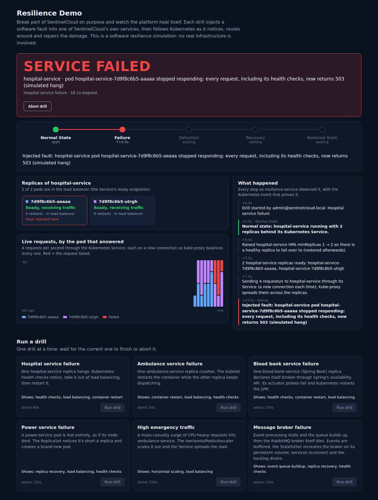
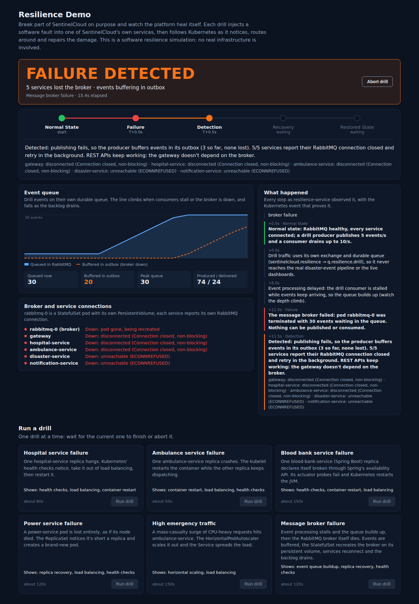

# Phase 11 — Failure Simulation (Resilience Demo)

> **Note (Phases 12–13).** Commands and behaviour in this phase document
> predate the security hardening and the engineering review. Notably: sign-up
> always creates a `CITIZEN` (no `role` field), the refresh token is an
> httpOnly cookie (login returns `accessToken`, not `session.accessToken`),
> every service except `/auth/docs` requires a Bearer token, and secrets come
> from `./scripts/generate-secrets.sh`. Current commands:
> [`SYSTEM-REFERENCE.md`](SYSTEM-REFERENCE.md), [`../SECURITY.md`](../SECURITY.md).


## Goal

Show *why* SentinelCloud needs a cloud-native platform by breaking parts of
it on purpose and letting the audience watch Kubernetes notice and repair
the damage, with no human intervention.

An administrator opens **Resilience Demo** in the dashboard, picks one of six
drills and presses **Run drill**. The page then walks through five stages,
each backed by evidence read live from the Kubernetes API:

```
Normal State  →  Failure  →  Detection  →  Recovery  →  Restored State
 (healthy)      SERVICE      probe fails /    restart /     traffic
                FAILED       HPA reacts       new pod /     balanced,
                             endpoint gone    scale-out     backlog drained
```

| # | Drill | What is broken | Kubernetes mechanism shown |
|---|---|---|---|
| 1 | Hospital service failure | one hospital-service replica **hangs** (every request, incl. health checks, returns 503) | readiness probe → removed from Service endpoints (load balancing); liveness probe → container restart |
| 2 | Ambulance service failure | one ambulance-service replica **crashes** (`exit(1)`) | kubelet restart (`restartPolicy: Always`), instant endpoint removal, other replica keeps serving |
| 3 | Blood service failure | one blood-bank-service (Spring Boot) replica **declares itself broken** via Spring's availability API (`LivenessState.BROKEN`) | actuator liveness/readiness groups → probe failure → JVM restarted |
| 4 | Power service failure | one power-service **pod is lost** entirely (deleted, as if its node died) | ReplicaSet creates a *replacement* pod; startup/readiness probes gate it |
| 5 | High emergency traffic | a CPU-heavy request surge hits ambulance-service | HorizontalPodAutoscaler scales out; the Service spreads load over new pods |
| 6 | Message broker failure | event consumers stall (queue builds up), then the **RabbitMQ pod dies** | StatefulSet recreates `rabbitmq-0` on the same PersistentVolume; services reconnect; outbox + durable queue → 0 events lost |

> **Scope.** This is a *software* resilience simulation. Faults are injected
> into SentinelCloud's own processes (a flag in memory, a process exit, a
> pod deletion) — no real infrastructure, network or hardware is touched,
> and drill traffic never enters the real disaster-event pipeline.



---

## 1. Architecture

```
 Browser ── /resilience page (React) ──► gateway /api/v1/resilience/* ──► resilience-service :8088
                                         (JWT; POST needs SYSTEM_ADMIN)      │
                                                                             │ ServiceAccount token (RBAC Role, ns only)
                       ┌─────────────────────────────────────────────────────┤
                       ▼                                                     ▼
            Kubernetes API server                          target pods, via their Service
     pods · events · endpointslices · HPA          POST /internal/chaos?mode=unhealthy|crash|clear
     (observe; delete a pod; patch HPA min)        GET  /internal/work  (CPU work for the surge)
                                                   header X-Chaos-Token  (shared secret)
                       ▼
            RabbitMQ management API :15672  (drill exchange/queue only)
```

### Components added

| Component | Where | What it does |
|---|---|---|
| **resilience-service** (new, Node 20, zero npm dependencies) | `services/resilience-service/` | Runs one drill at a time as a state machine; observes the cluster; serves the API the page polls; exports Prometheus metrics |
| **Fault-injection module** (Node) | `services/{hospital,ambulance}-service/src/chaos.js` | `/internal/chaos`, `/internal/whoami`, `/internal/work`; disabled unless `CHAOS_ENABLED=true` **and** a matching `X-Chaos-Token` |
| **Fault-injection package** (Spring) | `services/{blood-bank,power}-service/.../chaos/` | Same endpoints; `unhealthy` publishes `LivenessState.BROKEN` + `ReadinessState.REFUSING_TRAFFIC` through Spring Boot's own availability API |
| **Resilience Demo page** | `frontend/src/pages/ResiliencePage.jsx` | Banner, five-stage track, live pod grid, per-pod traffic chart, replica chart, queue chart, evidence timeline, summary |
| **Kubernetes objects** | `k8s/base/apps/resilience-service.yaml` | ServiceAccount, least-privilege Role/RoleBinding, ConfigMap, Deployment (1 replica, `Recreate`), ClusterIP Service |
| **Grafana** | System Health dashboard | New row "Resilience drills (Phase 11)": stage timeline per scenario + completed/not-completed counters |

### How a drill runs

`src/runner.js` — `ResilienceEngine.start()` creates a `Run` and executes the
scenario's `run(ctx)`. Every stage transition happens only when the
**cluster actually reaches that state** (`waitFor(…)` polling the API with
timeouts), never on a timer. Meanwhile a sampler calls `scenario.observe()`
every second to refresh the live view.

1. **Prepare** — raise the target's HPA `minReplicas` to 2 (so there is a
   healthy replica to fail over to) and wait for 2 Ready pods.
2. **Normal State** — start the request probe: 4 req/s through the
   Kubernetes Service, each on a *new* TCP connection (`agent:false`) so
   kube-proxy balances every request and the per-pod chart shows the split.
3. **Failure** — inject the fault (or delete the pod / start the load / stall
   the consumer then delete `rabbitmq-0`).
4. **Detection** — wait for Kubernetes' reaction: pod NotReady + gone from the
   EndpointSlice, HPA `desiredReplicas` up, publish failures + services
   reporting the broker disconnected. The matching **Kubernetes Event**
   (e.g. `Unhealthy: Readiness probe failed: HTTP probe failed with statuscode: 503`)
   is attached as evidence.
5. **Recovery** — wait for the repair: restart count +1, a replacement pod
   with a new name, new HPA replicas Ready, a new `rabbitmq-0` UID that is Ready.
6. **Restored State** — wait until the platform is back to normal (pod Ready
   and in the endpoints again, scale-out settled, backlog drained and every
   service reconnected), hold it on screen for a few seconds, then finish.
7. **Cleanup — always** (success, failure, abort or SIGTERM): clear injected
   faults on every target pod, restore the HPA's original `minReplicas`,
   stop load/probe/broker drill. The engine refuses a new drill (409) until
   cleanup has *finished*.

**Presentation pacing.** Some reactions happen within the same second (a
crashed container leaves the endpoints immediately). So the audience can
read each stage, the API presents every stage for at least
`minStageDisplayMs` (5 s). Only the *display* is paced: the drill itself
advances on real state and every timestamp shown (T+ offsets, timeline,
summary) is the real one.

### API (via the gateway at `/api/v1/resilience`)

| Method | Path | Who | Purpose |
|---|---|---|---|
| GET | `/scenarios` | any signed-in user | drill catalogue + availability |
| GET | `/overview` | any signed-in user | pods / ready endpoints / HPA of the four target services |
| GET | `/runs/current` | any signed-in user | the running (or last) drill, incl. live view + timeline |
| POST | `/runs` `{"scenarioId": "hospital-failure"}` | **SYSTEM_ADMIN** | start a drill → 202 (409 if one is running, 503 if unavailable) |
| POST | `/runs/current/abort` | **SYSTEM_ADMIN** | abort; cleanup still runs |
| GET | `/health`, `/health/ready`, `/metrics` | cluster-internal | probes + Prometheus |

Scenario ids: `hospital-failure`, `ambulance-failure`, `blood-failure`,
`power-failure`, `traffic-surge`, `broker-failure`.

Metrics: `sentinel_resilience_runs_total{scenario,outcome}`,
`sentinel_resilience_run_active`, `sentinel_resilience_stage_index{scenario}`
(0 = Normal … 4 = Restored).

---

## 2. Each drill in detail

Timings below are **measured on a real Kubernetes cluster** (k3s v1.31, one
2-core node) with the real manifests, probes, RBAC and HPAs — see
[§6](#6-verification-performed).

### 2.1 Hospital service failure — health checks + load balancing + restart

Fault: `POST /internal/chaos?mode=unhealthy` on one replica. From then on
every request — including `/health` and `/health/ready` — gets **503**,
like a process that is up but deadlocked.

| Stage | What Kubernetes does | Real timing |
|---|---|---|
| Detection | readiness probe (`/health/ready`, every 5 s, 3 failures) → pod NotReady → removed from the `hospital-service` EndpointSlice → kube-proxy sends every request to the healthy replica | 11.1 s |
| Recovery | liveness probe (`/health`, every 10 s, 3 failures) → kubelet kills and restarts the container; the fault lived only in memory, so the new process is healthy | 28.2 s |
| Restored | readiness passes, pod rejoins the endpoints, traffic is split 2 ways again | 32.2 s |

The traffic chart shows the window between failure and detection as red
bars on one pod's colour (83 % of requests succeeded during the incident in
the real run) and then 100 % on the surviving pod — exactly why readiness
probes matter.

### 2.2 Ambulance service failure — crash and restart

Fault: `mode=crash` → the process exits with code 1 after 100 ms.

| Stage | Real timing |
|---|---|
| Detection: container exited → pod NotReady → endpoint removed at once | 1.0 – 1.1 s |
| Recovery: kubelet restarts the container (`restartPolicy: Always`) | 2.1 – 2.2 s |
| Restored: startup + readiness probes pass, 2/2 serving | 6.2 – 7.1 s |

Only 1–2 requests out of ~30 failed (those in flight at the crash).
`kubectl get pods` shows `RESTARTS 1`.

### 2.3 Blood service failure — Spring Boot availability API

Fault: `mode=unhealthy` publishes `AvailabilityChangeEvent`s
(`LivenessState.BROKEN`, `ReadinessState.REFUSING_TRAFFIC`). Spring's own
actuator health groups `/health/liveness` and `/health/readiness` then
report DOWN — the same path a real Spring app takes when it detects an
unrecoverable internal error — and `ChaosFilter` makes business endpoints
return 503. Kubernetes reacts exactly as in 2.1 (real run: detect 11.1 s,
restart 32.2 s, restored 36.3 s). The JVM restart takes longer than Node's,
which the page makes visible.

### 2.4 Power service failure — pod loss and replica recovery

Fault: the pod is **deleted** through the API (what happens when a node
dies or a pod is evicted). Nothing restarts it — it's gone.

| Stage | Real timing |
|---|---|
| Detection: terminating pod leaves the endpoints; ReplicaSet sees 1/2 | 1.0 s |
| Recovery: ReplicaSet creates a **new pod with a new name** | 1.0 s |
| Restored: new pod passes startup/readiness, 2/2 again | 7.1 s |

100 % of requests succeeded in the real run: the other replica absorbed
everything. The summary points out the difference from 2.1–2.3: the lost
pod was *replaced*, not *repaired*.

### 2.5 High emergency traffic — horizontal scaling

resilience-service runs 8 concurrent request streams against
`/internal/work?ms=40` (40 ms of CPU each) on ambulance-service.

| Stage | Real run |
|---|---|
| Failure: "SERVICE OVERLOADED" — p95 latency jumps | p95 401 ms on 2 replicas |
| Detection: HPA measures CPU 244 % of request (target 70 %) → `SuccessfulRescale` New size: 4 | 15.2 s |
| Recovery: "SCALING OUT" — new pods Ready, Service adds them to the rotation | 20.3 s |
| Restored: "CAPACITY RESTORED" — scale-out settled | 21.3 s, 2 → 4 replicas |

After the drill the HPA scales back down after its stabilization window
(~2–3 minutes) — worth pointing at in Grafana.

**Honest note on latency.** On a single-node Minikube/Kind cluster every
replica shares the same CPU cores, so p95 latency barely improves (real run:
401 ms → 363 ms). The page says so explicitly instead of claiming a latency
win; the point being demonstrated is that the platform added capacity by
itself. On a multi-node cluster the new pods land on spare cores and latency
drops.

### 2.6 Message broker failure — queue buildup, broker recovery, zero loss

Uses an **isolated** exchange `sentinelcloud.resilience` and durable queue
`q.resilience.drill` via the RabbitMQ management API, so no real event ever
reaches the disaster pipeline or live dashboards.

1. **Normal**: a producer publishes 5 events/s (`delivery_mode: 2`,
   persistent); a consumer takes up to 10/s.
2. **Message delay**: the consumer is stalled for 6 s → the **queue builds
   up** (Event queue chart climbs).
3. **Failure**: pod `rabbitmq-0` is deleted with the backlog inside.
4. **Detection**: publishes fail → the producer keeps events in its
   **outbox** (dashed line); all 5 broker clients (gateway, hospital,
   ambulance, disaster, notification) report `disconnected (…, non-blocking)`
   in `/health/ready` — and stay Ready, because REST does not depend on the
   broker (Phase 9/10 design).
5. **Recovery**: the StatefulSet recreates `rabbitmq-0` — same name, **same
   PersistentVolume** `data-rabbitmq-0` — so the durable queue and its
   messages survive; the outbox flushes; the consumer resumes.
6. **Restored**: backlog drained to steady state, 5/5 services reconnected
   on their own, **events lost: 0**.

Real run: broker back in 12.1 s, peak queue 100, 56 events buffered,
280 produced / 279 delivered (1 in flight at the end), 0 lost, restored at
34.2 s.



---

## 3. Security model

Deliberately breaking services is a dangerous capability, so it is locked
down in layers:

| Layer | Control |
|---|---|
| User | Starting/aborting a drill requires a valid access JWT with role **SYSTEM_ADMIN** — enforced by the gateway (`WRITE_ROLES_BY_PREFIX.resilience`) **and** again by resilience-service (HS256 signature, `exp`/`nbf`, issuer, token type). Other roles can watch, not act. |
| Network edge | The gateway returns **404 for any `/internal` path** under `/api/v1`, before authentication. Fault endpoints are unreachable from outside the cluster. |
| Target services | `/internal/*` exists only when `CHAOS_ENABLED=true` (set in the Kubernetes ConfigMaps only; default `false` everywhere else) **and** the request carries `X-Chaos-Token` equal to `RESILIENCE_CHAOS_TOKEN` (timing-safe comparison). Otherwise: 404, indistinguishable from a missing route. |
| Kubernetes | resilience-service's ServiceAccount has a namespace-scoped Role: get/list/delete **pods**, list events/endpointslices, get deployments/statefulsets, get/patch **HPAs** — nothing else. Verified: it *cannot* delete deployments, create pods, read secrets, patch deployments, or touch any other namespace. |
| Blast radius | One drill at a time; one replica targeted; HPA minimum raised first so service never drops to zero; guaranteed cleanup (also on SIGTERM); isolated drill queue. |

Faults themselves are harmless by construction: `unhealthy` is a flag in
memory (cleared by restart or `mode=clear`), `crash` is a normal process
exit, `work` is capped at 500 ms of CPU per request.

---

## 4. Running it

### Kubernetes (Kind or Minikube) — the real demo

```bash
# 1. Rebuild images: there is a new one (resilience-service) and the four
#    target services gained fault-injection code. 10 images now.
./scripts/k8s-build-images.sh kind          # or: ./scripts/k8s-build-images.sh minikube

# 2. Add the new secret key (Linux/macOS/Git Bash):
echo "RESILIENCE_CHAOS_TOKEN=$(openssl rand -hex 24)" >> k8s/overlays/local/secrets.env
#    PowerShell:
#    Add-Content k8s/overlays/local/secrets.env "RESILIENCE_CHAOS_TOKEN=$([guid]::NewGuid().ToString('N'))"
#    (or re-copy secrets.env.example, which contains a dev value)

# 3. Apply. The Secret name gets a new hash suffix, so every Deployment that
#    uses it rolls out automatically and picks up the token.
kubectl apply -k k8s/overlays/local
kubectl rollout status deployment -n sentinelcloud --timeout=600s
kubectl get pods -n sentinelcloud -l app.kubernetes.io/name=resilience-service

# 4. Open http://localhost:30080 → log in as admin@sentinelcloud.local with the
#    DEFAULT_ADMIN_PASSWORD from k8s/overlays/local/secrets.env (Phase 12: random)
#    → "Resilience Demo" in the navigation.
```

The traffic drill needs **metrics-server** (installed in the Phase 9
cluster steps); without it the HPA shows `<unknown>` and the drill stops
with "timed out waiting for the HPA to react (is metrics-server installed?)".

### Drive it from the command line (optional)

```bash
TOKEN=$(curl -s -X POST localhost:30080/api/v1/auth/login -H 'content-type: application/json' \
  -d "{\"email\":\"admin@sentinelcloud.local\",\"password\":\"$(grep ^DEFAULT_ADMIN_PASSWORD= k8s/overlays/local/secrets.env | cut -d= -f2)\"}" | jq -r .accessToken)
curl -s -H "Authorization: Bearer $TOKEN" localhost:30080/api/v1/resilience/scenarios | jq '.scenarios[].id'
curl -s -X POST -H "Authorization: Bearer $TOKEN" -H 'content-type: application/json' \
  -d '{"scenarioId":"ambulance-failure"}' localhost:30080/api/v1/resilience/runs
curl -s -H "Authorization: Bearer $TOKEN" localhost:30080/api/v1/resilience/runs/current | jq '.run.stage, .run.banner'
curl -s -X POST -H "Authorization: Bearer $TOKEN" localhost:30080/api/v1/resilience/runs/current/abort
```

(Field names of the login response are as documented in Phase 2.)

Useful terminal views to put next to the page during a drill:

```bash
kubectl get pods -n sentinelcloud -w                      # restarts, new pods, rabbitmq-0 recreated
kubectl get endpointslices -n sentinelcloud -l kubernetes.io/service-name=hospital-service -w
kubectl get hpa ambulance-service -n sentinelcloud -w     # traffic drill
kubectl get events -n sentinelcloud --sort-by=.lastTimestamp | tail -20
```

### Docker Compose

resilience-service also starts under Compose, and the page loads, but every
drill is disabled with a notice that it needs Kubernetes. That is the point of the
phase: Compose's `restart:` policy can restart a crashed container, but it
has no readiness-based load balancing, no replica replacement, no
autoscaling and no self-healing stateful sets. There is nothing to
demonstrate.

---

## 5. Presentation script (~10 minutes)

**Before (T−15 min):** cluster up, all pods Ready, log in as admin, open
three tabs: (1) Resilience Demo, (2) Grafana → SentinelCloud System Health,
(3) a terminal with `kubectl get pods -n sentinelcloud -w`. Run the
ambulance drill once as a warm-up (it takes ~45 s) so images and caches are
hot. Wait ~3 minutes afterwards for HPAs to settle back to 1 replica.

1. **Frame it (30 s).** "In an emergency platform a failed service is not an
   inconvenience. I'm going to break SentinelCloud on purpose, live, and not
   touch anything while it fixes itself."
2. **Hospital hang (90 s).** Run *Hospital service failure*. On SERVICE
   FAILED point at the red bars: requests are still being sent to the broken
   pod. On FAILURE DETECTED: "the readiness probe failed 3 times, so
   Kubernetes took it out of the load balancer — every request now goes to
   the healthy pod." Show the Kubernetes event in the timeline. On
   SELF-HEALING: liveness restart; tab 3 shows `RESTARTS 1`.
3. **Crash (60 s).** *Ambulance service failure*: detected and restarted in
   about a second. Contrast: "a hang needs probes to be noticed; a crash is
   noticed immediately."
4. **Pod loss (60 s).** *Power service failure*: in tab 3 a pod with a
   **new name** appears. "This is what happens when a whole machine dies —
   the ReplicaSet doesn't repair, it replaces."
5. **Traffic surge (2 min).** *High emergency traffic*: OVERLOADED → the
   HPA's CPU reading and its decision appear → new colours in the traffic
   chart as new pods take their share. Switch to Grafana to show the same
   scale-out on the HPA panel and the drill stage timeline.
6. **Broker failure (2 min).** *Message broker failure*: the queue climbs
   while consumers are stalled; the broker dies; the outbox line rises; all
   five services report disconnected **but stay up**; the StatefulSet brings
   `rabbitmq-0` back on its volume; backlog drains; "events lost: 0".
7. **Close (30 s).** "Six failures, zero human actions, zero events lost.
   That's why this runs on Kubernetes and not on a VM with a start script."

If a drill misbehaves live: press **Abort drill** — cleanup restores the
cluster — and continue with the next one. The page always shows why a drill
stopped.

---

## 6. Verification performed

| Check | Result |
|---|---|
| resilience-service unit + integration tests (`npm test`) | **38/38 pass** — all six scenarios end-to-end against a time-compressed simulated cluster (kubelet, endpoints, ReplicaSet, HPA, kube-proxy, RabbitMQ), plus abort, timeout, conflict, unavailable, JWT, HTTP API, metrics, stage pacing, broker drain at every sampling phase, busy-until-cleanup |
| Fault module tests (hospital, ambulance) | 8/8 each; the two files are identical |
| Spring chaos package | compiles with `javac` (Maven Central is not reachable from the build sandbox, so the Spring tests were not run) |
| Manifests | server-side dry run on k3s accepts all objects; `kubectl kustomize` renders |
| **Real Kubernetes run (k3s v1.31, 1 node, 2 cores)** | The **real resilience-service image**, the real Deployment/Service/ConfigMap/**RBAC Role**, the real target-service Deployments with their **real probes, resources and HPAs**, metrics-server, and the RabbitMQ StatefulSet + PVC (its probes switched to TCP for the stand-in; init containers that wait for Postgres were dropped since no database was involved). All six drills run through the API with a real admin JWT: **all completed** with the timings quoted in §2. Also verified live: 401 without token, 403 for a non-admin start, 409 for a concurrent start, abort mid-drill → faults cleared and HPA minimum restored, and the RBAC boundary (`kubectl auth can-i`). |
| Frontend | Resilience page rendered in headless Chromium against the real resilience-service API; every drill type driven through all five banners with 0 console errors; screenshots in `docs/images/phase-11/` |
| `docker compose config` | valid |

**What was *not* exercised, for honesty:** in the k3s run, the application
containers were lightweight stand-ins (a Node HTTP server running the
**real `chaos.js`** and real `metrics.js`), and RabbitMQ was a stand-in
implementing the management-API subset the drill uses and persisting its
queue to the real PVC. The real Express/Spring services, real RabbitMQ,
Grafana and the gateway → resilience-service hop were not run in this
environment (their container images can't be pulled or built here). The
Kubernetes behaviour — probes, endpoints, restarts, ReplicaSet, HPA,
StatefulSet + PVC, RBAC — is real.

**Bugs found by the real-cluster run, and fixed:**

1. *Broker drill never reached "restored".* The restore check polled every
   1000 ms and the drill consumer also ran every 1000 ms; the two locked in
   phase and the check always sampled just before a consume, when the queue
   held ~5 events (one second of arrivals), so `depth ≤ 2` was never true.
   Now `BrokerDrill.isDrained()` uses the steady-state depth for one consume
   interval and tolerates the one publish in flight; a regression test checks
   every sampling phase.
2. *A new drill could start while the previous one was still cleaning up*
   (`isRunning()` looked at `status`, which becomes final before cleanup
   runs). The engine now stays busy until cleanup finishes.
3. *Crash/pod-loss drills skipped straight past "SERVICE FAILED"* because
   detection really is sub-second → stage pacing (§1).
4. *Recovery banner said "flushing 0 buffered events"* when the outbox had
   already flushed → now reports how many buffered events were delivered.

---

## 7. Likely errors and fixes

| Symptom | Cause | Fix |
|---|---|---|
| Warning above the drills: **"No CHAOS_TOKEN configured…"**, Run buttons disabled | `RESILIENCE_CHAOS_TOKEN` missing from `secrets.env` (the key is `optional`, so pods still start) | Add it (§4 step 2) and `kubectl apply -k k8s/overlays/local` |
| Drill stops with "fault injection into <pod> failed (HTTP 404). Is CHAOS_ENABLED=true and CHAOS_TOKEN set…?" | The target pod runs an image built before Phase 11, or its token differs | Rebuild images (`k8s-build-images.sh`), re-apply; check `kubectl get deploy hospital-service -n sentinelcloud -o yaml \| grep -A3 CHAOS` |
| Warning: "resilience-service is not running inside Kubernetes…" | Running under Docker Compose (or outside a cluster) | Expected; use Kind/Minikube |
| `403 Forbidden` from the Kubernetes API in resilience-service logs | Role/RoleBinding not applied, or the namespace isn't `sentinelcloud` | Re-apply the overlay; the RoleBinding subject is `system:serviceaccount:sentinelcloud:resilience-service` |
| Traffic drill: "timed out waiting for the HPA to react" | metrics-server missing or not ready (HPA `TARGETS <unknown>`) | Install/patch metrics-server (Phase 9), wait for `kubectl top pods` to work |
| Traffic drill starts with 3–5 replicas already | HPA hasn't scaled down from a previous drill (stabilization window) | Wait ~3 min between traffic drills; the drill still works, just from a higher baseline |
| "Run drill" shows "a drill is already running" (HTTP 409) | A drill, or the last drill's cleanup (~1–2 s after it ends), is still in progress | Wait a moment, or press Abort |
| Broker drill: "rabbitmq-0 is not ready" | RabbitMQ still starting | Wait for `rabbitmq-0` 1/1 Ready |
| Probes / everything time out on a small laptop | Not enough CPU for the whole stack + a surge | Give Docker ≥ 4 CPUs (Phase 9); run the traffic drill last |
| "Starting one needs a SYSTEM_ADMIN account", Run buttons disabled | Signed in with another role — viewing is allowed, acting is not | Log in as a `SYSTEM_ADMIN` |

---

## 8. Code changes in this phase

- **New** `services/resilience-service/` — `src/{index,runner,scenarios,probes,k8s,rabbit,jwt,http,metrics}.js`, `Dockerfile`, tests (`tests/fakeCluster.js` + 5 test files).
- **New** `services/{hospital,ambulance}-service/src/chaos.js` (+ tests), wired in `src/index.js` after the metrics middleware.
- **New** Spring `chaos/` package in blood-bank-service and power-service (`ChaosState`, `ChaosFilter`, `ChaosController`), `SecurityConfig` permits `/internal/**` (token-checked in the controller), `application.yml` `sentinel.chaos.*`.
- Gateway: blocks `/internal` paths; routes `/api/v1/resilience` (writes: SYSTEM_ADMIN).
- Kubernetes: `k8s/base/apps/resilience-service.yaml`; `CHAOS_ENABLED`/`CHAOS_TOKEN` on the four targets; gateway `RESILIENCE_SERVICE_URL`; overlay image tag; `secrets.env.example` gains `RESILIENCE_CHAOS_TOKEN`; build script builds 10 images.
- Compose: resilience-service container; Prometheus scrape job.
- Grafana: "Resilience drills" row on System Health.
- Frontend: `/resilience` route + nav link "Resilience Demo", `ResiliencePage.jsx`, API helpers in `lib/api.js`.

---

## 9. Known limitations

- **One drill at a time, state in memory.** If the resilience-service pod
  itself restarts mid-drill, that drill's history is lost (SIGTERM still
  triggers cleanup; a hard kill could leave an `unhealthy` flag, which the
  victim's liveness probe clears by restarting it within ~30 s, and an HPA
  minimum of 2, which you can reset with
  `kubectl patch hpa <svc> -n sentinelcloud --type merge -p '{"spec":{"minReplicas":1}}'`).
- **Single-node latency.** See §2.5 — scale-out adds capacity but can't add
  CPU cores that don't exist.
- **Drill traffic is synthetic.** The probe and surge hit
  `/health`-style and `/internal/work` endpoints, not business endpoints, so
  no data is created or modified.
- **The broker drill tests the platform's recovery, not the services' event
  handlers.** It uses an isolated queue so the live dashboards stay clean.
- Spring services restart slower than Node ones (JVM startup); blood/power
  drills take ~2× longer.
